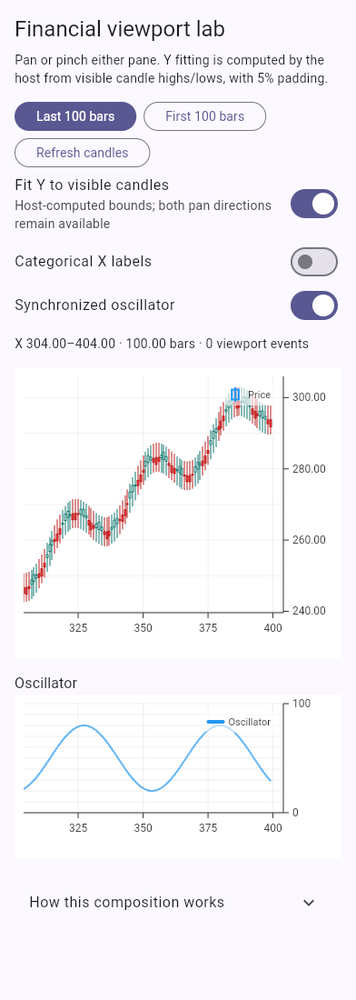

# Financial viewport composition

The Financial viewport lab demonstrates Candlestick and oscillator panes on
one synchronized X timeline. Open the showcase with
`?page=financial-viewport-lab`. The explicit route also works on phones.

The sample addresses the host composition described in
[issue #175](https://github.com/braven-pvm/braven_charts/issues/175). Its source
is [FinancialViewportLabPage](../../example/lib/showcase/pages/financial_viewport_lab_page.dart).



## Ownership and initialization

Create one `ChartInteractionGroupController` in the host State and supply it
to every pane. Call `setViewport` once for the initial window; mounted charts
receive it and charts that attach later inherit it. Dispose the group with
the host. Keep chart keys and the group stable across host rebuilds.

```dart
final group = ChartInteractionGroupController();
group.setViewport(const ChartXViewport(min: 304, max: 404));
```

Group synchronization shares X bounds only. Price and oscillator Y ranges
remain independent. Give each pane the full X domain in `XAxisConfig`; use
the group to choose the visible window. The source domain and visible window
are separate concepts. Reserve the same left/right axis widths to align panes.

## Fit price Y from visible source candles

`InteractionConfig.onViewportChanged` reports `minX`, `maxX`, `minY`, and
`maxY`. A host may observe those values to update readouts or calculate a
new price Y range. For a candle whose X lies inside the window, use its
complete `low` and `high`, not its close alone. Add padding to both ends.

```dart
({double min, double max})? visiblePriceBounds(
  List<CandlestickDataPoint> candles,
  ChartXViewport window,
) {
  double? minimum;
  double? maximum;
  for (final candle in candles) {
    if (candle.x < window.min || candle.x > window.max) continue;
    if (minimum == null || candle.low < minimum) minimum = candle.low;
    if (maximum == null || candle.high > maximum) maximum = candle.high;
  }
  if (minimum == null || maximum == null) return null;
  final span = maximum - minimum;
  final padding = span > 0 ? span * 0.05 : 0.01;
  return (min: minimum - padding, max: maximum + padding);
}
```

Pass the result to `YAxisConfig(min: ..., max: ...)` on the price pane. Keep
the previous valid range when the visible window has no candles. The lab
recalculates on viewport changes and source refreshes; no reject-and-restore
viewport callback is used. This small example scans 400 source candles. For
large histories, a host should index the ordered source instead of scanning
the whole history for each pointer update.

An explicit Y configuration change must take effect without replacing X.
Rebuilding unchanged chart input must preserve the user's visible window.
These lifecycle behaviors are protected by
`test/widgets/financial_viewport_rebuild_test.dart`.

## Mobile configuration and current limitations

```dart
InteractionConfig(
  enablePan: true,
  enableZoom: true,
  touch: const TouchInteractionConfig(
    profile: TouchInteractionProfile.explore,
    enablePan: true,
    enablePinchZoom: true,
  ),
  onViewportChanged: onViewportChanged,
)
```

Explore allows one-finger pan; pinch zoom uses two fingers. The default Browse
profile leaves one-finger dragging to page scrolling. Read the
[mobile interaction guide](mobile-interaction.md) for the complete policy.

The lab computes Y fitting in the host. It does not introduce a native
visible-data auto-fit option. Current `enablePan` controls both directions;
it cannot independently disable vertical panning. Native axis-specific
navigation and visible-data Y fitting require a separate public API change.

In 0.18.0, changing only an axis configuration may leave its resolved bounds
stale, and replacing a disjoint Y domain can reset X. Pan clamping can also
snap a host-fitted viewport back toward its original bounds, even on an axis
with zero requested movement. The issue #175 fix addresses these lifecycle
and clamping defects: a constrained drag never reverses or exceeds the
requested movement, and an untouched axis stays untouched. It has to be
merged and released before the correction is available through a pub.dev
dependency.

## Reviewing a suspected viewport jump

Compare numeric and categorical X labels, one and two panes, and Y fitting
on/off. Include slow horizontal and diagonal drags: neither pane should snap
vertically while the X window remains steady. Pan and pinch either pane,
lift one finger before the other, and refresh candles during the active
gesture. Check the X readout before and
after each operation. The lab's first/last-window buttons deliberately move
the viewport and should not be confused with an unexpected jump.

Automated touch events establish package behavior, but do not substitute
for native Android/iOS or mobile-browser verification. Include the platform,
device, OS, Flutter/package versions, and a reduced dataset in a bug report.
